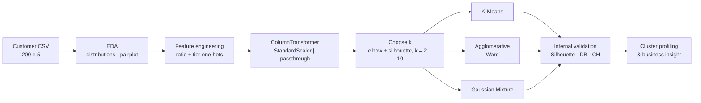
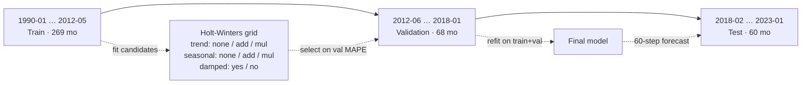

# Unsupervised Learning & Time-Series Forecasting

Two studies from an applied machine learning project:

| Part | Notebook | Task | Methods | Headline result |
|---|---|---|---|---|
| **A** | [`p2510877_CA2_PartA_KendrickSlamat.ipynb`](p2510877_CA2_PartA_KendrickSlamat.ipynb) | Customer segmentation | K-Means · Agglomerative (Ward) · Gaussian Mixture | 7 behavioural segments; K-Means best on all three internal validity indices (Silhouette 0.42, DB 0.85, CH 154) |
| **B** | [`p2510877_CA2_PartB_KendrickSlamat.ipynb`](p2510877_CA2_PartB_KendrickSlamat.ipynb) | 60-month energy-demand forecasting | Simple & Holt-Winters exponential smoothing, ADF tests, classical seasonal decomposition, residual diagnostics | Gas forecast **11.9% MAPE** over a 5-year blind horizon with unbiased, normal, uncorrelated residuals |

**Stack:** Python · scikit-learn · statsmodels · SciPy · pandas · NumPy · matplotlib · seaborn

---

## Highlights

- Segmented 200 retail customers into **7 interpretable personas** using an engineered **spend-to-income ratio** and income/spend tiers. Benchmarked three clustering families (centroid, hierarchical, probabilistic) on Silhouette, Davies–Bouldin and Calinski–Harabasz.
- Found a **high-income / low-spend segment (16.5% of customers)** as the main revenue opportunity, which gives a concrete, data-backed targeting recommendation.
- Built a **leakage-free chronological train / validation / test protocol** (269 / 68 / 60 months) for 33 years of monthly gas, electricity and water data, with model selection done only on the validation window.
- Grid-searched **trend × seasonality × damping** Holt-Winters configurations per series. Validation MAPE fell 21% for gas and 76% for electricity relative to a simple exponential smoothing baseline.
- Ran **full residual diagnostics** (bias, Shapiro–Wilk, Q-Q, ACF), which showed that a low error metric can hide a structurally broken forecast. Root-caused a flat electricity forecast to a configuration regression between tuning and refitting.

---

## Part A: Customer Segmentation

### Problem

Group 200 shop customers into segments that marketing can act on, and identify the segment that most deserves attention.

### Data

`datasets/CA2-Customer-Data.csv`: 200 rows with `Gender`, `Age` (18–70), `Income (k$)` (15–137) and `How Much They Spend` (spending score, 1–99). No missing values or duplicates.

### Feature engineering

| Feature | Definition | Rationale |
|---|---|---|
| `Income_Spending_Ratio` | spend ÷ income | Spending intensity relative to means. It separates "enthusiasts" from "savers" at the same income |
| `Income_Category_{Low,Medium,High}` | income < 50 / 50–90 / > 90 k$, one-hot | Discrete affordability tiers; reduce sensitivity to high-income outliers |
| `Spending_Category_{Frugal,Moderate,High}` | spend < 30 / 30–60 / > 60, one-hot | Wallet-share tiers that keep the clusters interpretable |

The final clustering space has **10 dimensions**: 4 standardised continuous features plus 6 binary indicators, assembled with a `ColumnTransformer` (`StandardScaler` + passthrough) inside a `make_pipeline` for each algorithm.

### Pipeline



### Choosing k

| k | 2 | 3 | 4 | 5 | 6 | **7** | 8 | 9 | 10 |
|---|---|---|---|---|---|---|---|---|---|
| Inertia | 864 | 562 | 420 | 386 | 323 | **236** | 204 | 177 | 150 |
| Silhouette | 0.22 | 0.30 | 0.36 | 0.34 | 0.36 | **0.43** | 0.43 | 0.43 | 0.45 |

At **k = 7** the silhouette score reaches its plateau and inertia drops sharply from k = 6. k = 10 gives only +0.02 silhouette and would split the 200 customers into segments too small to act on.

### Algorithm comparison (k = 7)

| Algorithm | Silhouette ↑ | Davies–Bouldin ↓ | Calinski–Harabasz ↑ |
|---|---:|---:|---:|
| **K-Means** | **0.422** | **0.852** | **154.1** |
| Gaussian Mixture | 0.405 | 0.852 | 145.9 |
| Agglomerative (Ward) | 0.366 | 0.968 | 131.8 |

K-Means and GMM produce identical sizes for five of the seven clusters, which means the partition is stable across the two model families. GMM's full-covariance flexibility brings no benefit at this sample size, so K-Means was chosen for its simplicity.

### Segment profiles (K-Means)

| Cluster | n (%) | Age | Income (k$) | Spend | Spend/Income | Persona |
|---:|---:|---:|---:|---:|---:|---|
| 0 | 48 (24.0%) | 55.7 | 54.8 | 48.2 | 0.91 | Mature mid-income, moderate spenders |
| 1 | 39 (19.5%) | 32.7 | 86.5 | 82.1 | 0.98 | **Affluent high spenders** (core VIPs) |
| 2 | 25 (12.5%) | 25.5 | 25.5 | 75.4 | 3.23 | Young, low income, high spend (impulse buyers) |
| 3 | 11 (5.5%) | 42.6 | 108.2 | 21.3 | 0.20 | **High-income savers** |
| 4 | 22 (11.0%) | 39.4 | 79.1 | 13.4 | 0.17 | **Upper-middle income, very low spend** |
| 5 | 19 (9.5%) | 46.2 | 26.1 | 17.4 | 0.68 | Low income, frugal |
| 6 | 36 (18.0%) | 27.0 | 56.8 | 49.4 | 0.90 | Young mid-income, moderate spenders |

**Key finding.** Clusters 3 and 4 (33 customers, 16.5%) have above-average income (79–108 k$) but the **lowest spend-to-income ratios in the population (0.17–0.20)**. This is the largest gap between ability to pay and actual spending, so these clusters are the priority for premium bundles, personalised offers and loyalty incentives. Cluster 1 is the segment to retain. Cluster 2 has a spend-to-income ratio of 3.2, more than 3× that of any other segment, and may respond to credit or instalment products.

---

## Part B: 60-Month Energy Consumption Forecasting

### Problem

Forecast monthly **gas (tons)**, **electricity (MWh)** and **water (tons)** consumption 60 months ahead to support supply and capacity planning.

### Data

`datasets/CA2-Energy-Consumption-Data.csv`: 397 monthly observations (Jan 1990 – Jan 2023), with no gaps after reindexing to month-start frequency.

### Exploratory diagnostics

| Series | ADF statistic | p-value | Stationary? | Decomposition |
|---|---:|---:|---|---|
| Gas | −3.40 | 0.011 | Yes | Multiplicative; winter-peaking seasonality, mild upward trend |
| Electricity | −2.26 | 0.186 | **No** (trend) | Additive; steady upward trend, regular seasonality |
| Water | −4.68 | < 0.001 | Yes | Multiplicative; irregular trend, high volatility |

### Experimental protocol



The split is strictly chronological with no shuffling. The test window is touched only once, for the final evaluation.

### Validation results (model selection)

| Series | Baseline: SES MAPE | Holt-Winters default (add/add/damped) | Selected config MAPE | Selected config |
|---|---:|---:|---:|---|
| Gas | 25.4% | 27.1% | **20.0%** (−21%) | multiplicative trend, no seasonality |
| Electricity | 9.8% | 2.9% | **2.4%** (−76%) | additive seasonality, no trend |
| Water | 71.2% | 70.0% | **70.2%** (−1%) | additive seasonality, no trend¹ |

¹ For water, the notebook fixes the most parsimonious seasonal configuration by hand instead of taking the raw grid-search winner, because validation MAPE on this window is unreliable (see Finding 3).

### Test results (60-month blind forecast, refit on train+val)

| Series | Test MAPE | MAE | RMSE | Residual mean | Shapiro–Wilk p | Verdict |
|---|---:|---:|---:|---:|---:|---|
| **Gas** | **11.9%** | 3.0 t | 3.7 t | −0.07 | 0.41 | Well specified: unbiased, normal, no residual autocorrelation |
| Electricity | 13.9% | 135 MWh | 159 MWh | −125 | 0.03 | Systematic **over-forecast** and flat trajectory |
| Water | 17.9% | 82 t | 105 t | +26 | 0.39 | Mild under-forecast; autocorrelated residuals |

### Findings & error analysis

1. **Gas is ready for planning use.** Test MAPE (11.9%) is *better* than validation MAPE (20.0%), and the residuals pass every diagnostic. The multiplicative trend term carries the signal.
2. **Electricity: low validation error did not carry over to the test set.** The grid search chose seasonal Holt-Winters (2.4% val MAPE), but the final refit dropped the seasonal term, which turned the model back into simple exponential smoothing. The result is a **constant forecast of 1,155 MWh** for all 60 months against an actual mean of 1,030 ± 97 MWh, with residuals biased by −125 MWh. The ADF test had already flagged a unit root, so the obvious fix is to restore the tuned seasonal configuration and add a (damped) trend or difference the series (SARIMA with d = 1).
3. **Water shows a regime shift.** Validation MAPE (70%) is far worse than test MAPE (18%). The 2012–2018 validation window contains the series minimum (44 t in Feb 2014, against a training-period mean of 472 t). Near-zero actual values inflate MAPE, so model selection on that window is unreliable. Rolling-origin cross-validation or a robust loss such as MASE would give a more trustworthy selection signal.
4. **Point forecasts are over-smoothed.** Forecast ranges cover only ~14–15% of the realised range for gas and water. Prediction intervals, which `statsmodels` provides through simulation, should accompany any operational use.

### Limitations & future work

- A single validation origin gives one noisy MAPE estimate; **rolling-origin (time-series) CV** would make model selection more robust.
- MAPE is unstable when actual values approach zero, which matters for water. **MASE or sMAPE** are better choices for that series.
- `SARIMAX` is imported but not yet used. Seasonal ARIMA with **exogenous drivers** (temperature, rainfall, economic activity) is the natural next experiment.
- Electricity, gas and water are probably correlated. A **multivariate** model (VAR or gradient-boosted lag features) could take advantage of that.
- For Part A, the internal validity indices were computed on the raw 4-feature space, not the 10-D clustering space. Computing them in the clustering space, and checking stability with bootstrap resampling (e.g. adjusted Rand index across resamples), would make the model comparison stronger.

---

## Repository Structure

```
unsupervised-learning/
├── p2510877_CA2_PartA_KendrickSlamat.ipynb   # Part A: customer segmentation
├── p2510877_CA2_PartB_KendrickSlamat.ipynb   # Part B: energy forecasting
├── p2510877_CA2_KendrickSlamat.pptx          # Presentation of methods and findings
├── datasets/
│   ├── CA2-Customer-Data.csv                 # 200 customers
│   └── CA2-Energy-Consumption-Data.csv       # 397 months, 1990–2023
└── LICENSE                                   # MIT
```

## Reproducing the Results

```bash
git clone https://github.com/pufferfish3e/unsupervised-learning.git
cd unsupervised-learning
python -m venv .venv && source .venv/bin/activate
pip install numpy pandas scikit-learn scipy statsmodels matplotlib seaborn jupyter
jupyter notebook
```

Run each notebook top to bottom. Clustering models use `random_state=42`, and exponential-smoothing fits are deterministic.

## Author

**Kendrick Slamat**: AI & Machine Learning (ST1511), CA2. Released under the [MIT License](LICENSE).
