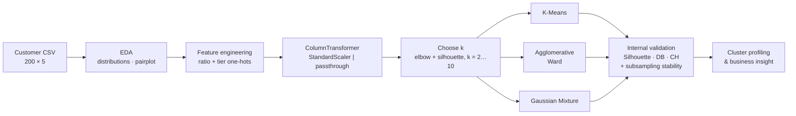
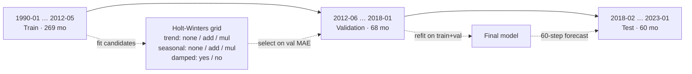

# Unsupervised Learning & Time-Series Forecasting

Two studies from an applied machine learning project:

| Part | Notebook | Task | Methods | Headline result |
|---|---|---|---|---|
| **A** | [`p2510877_CA2_PartA_KendrickSlamat.ipynb`](p2510877_CA2_PartA_KendrickSlamat.ipynb) | Customer segmentation | K-Means · Agglomerative (Ward) · Gaussian Mixture | 7 behavioural segments; K-Means and Ward tied on internal validity (Silhouette 0.43), checked with a subsampling stability test |
| **B** | [`p2510877_CA2_PartB_KendrickSlamat.ipynb`](p2510877_CA2_PartB_KendrickSlamat.ipynb) | 60-month energy-demand forecasting | Simple & Holt-Winters exponential smoothing, ADF tests, seasonal decomposition with trend/seasonal strength, residual diagnostics, simulated prediction intervals | Electricity forecast **3.0% MAPE** over a 5-year blind horizon; 95% intervals cover 97–100% of test months |

**Stack:** Python · scikit-learn · statsmodels · SciPy · pandas · NumPy · matplotlib · seaborn

---

## Highlights

- Segmented 200 retail customers into **7 interpretable personas** using an engineered **spend-to-income ratio** and income/spend tiers. Benchmarked three clustering families (centroid, hierarchical, probabilistic) on Silhouette, Davies–Bouldin and Calinski–Harabasz, and tested **cluster stability** with 50 subsampling runs (adjusted Rand index).
- Found a **high-income / low-spend segment (16.5% of customers)** as the main revenue opportunity, which gives a concrete, data-backed targeting recommendation.
- Built a **leakage-free chronological train / validation / test protocol** (269 / 68 / 60 months) for 33 years of monthly gas, electricity and water data, with model selection done only on the validation window.
- Grid-searched 15 **trend × seasonality × damping** Holt-Winters configurations per series, selected on validation **MAE** because a near-zero reading makes MAPE unreliable. Validation MAE fell **77% for electricity**, 16% for gas and 13% for water compared with a simple exponential smoothing baseline.
- Found and fixed a bug where the final refit dropped the tuned seasonal term for electricity. Fixing it cut the 60-month test error from **13.9% to 3.0% MAPE**.
- Quantified **trend and seasonal strength**: only electricity is seasonal (0.89), while gas and water are not (0.02 and 0.06). This explains why seasonal models help only electricity.
- Ran **residual diagnostics** (bias, Shapiro–Wilk, Q-Q, ACF) and **simulation-based 95% prediction intervals** on the blind test window.

---

## Part A: Customer Segmentation

### Problem

Group 200 shop customers into segments that marketing can act on, and identify the segment that most deserves attention.

### Data

`datasets/CA2-Customer-Data.csv`: 200 rows with `Gender`, `Age` (18–70), `Income (k$)` (15–137) and `How Much They Spend` (spending score, 1–99). No missing values or duplicates.

### Feature engineering

| Feature | Definition | Rationale |
|---|---|---|
| `Income_Spending_Ratio` | spend ÷ income | Spending intensity relative to means. It separates "enthusiasts" from "savers" at the same income |
| `Income_Category_{Low,Medium,High}` | income < 50 / 50–90 / > 90 k$, one-hot | Discrete affordability tiers; reduce sensitivity to high-income outliers |
| `Spending_Category_{Frugal,Moderate,High}` | spend < 30 / 30–60 / > 60, one-hot | Wallet-share tiers that keep the clusters interpretable |

The final clustering space has **10 dimensions**: 4 standardised continuous features plus 6 binary indicators, assembled with a `ColumnTransformer` (`StandardScaler` + passthrough) inside a `make_pipeline` for each algorithm.

### Pipeline



### Choosing k

| k | 2 | 3 | 4 | 5 | 6 | **7** | 8 | 9 | 10 |
|---|---|---|---|---|---|---|---|---|---|
| Inertia | 864 | 562 | 420 | 386 | 323 | **236** | 204 | 177 | 150 |
| Silhouette | 0.22 | 0.30 | 0.36 | 0.34 | 0.36 | **0.43** | 0.43 | 0.43 | 0.45 |

At **k = 7** the silhouette score reaches its plateau and inertia drops sharply from k = 6. k = 10 gives only +0.02 silhouette and would split the 200 customers into segments too small to act on.

### Algorithm comparison (k = 7)

All indices are computed in the scaled 10-D space the clusters were fitted in. Stability is the mean adjusted Rand index (ARI) between the full-data clustering and 50 re-fits on random 80% subsamples.

| Algorithm | Silhouette ↑ | Davies–Bouldin ↓ | Calinski–Harabasz ↑ | Stability (ARI) ↑ |
|---|---:|---:|---:|---:|
| **K-Means** | **0.428** | 0.892 | **110.2** | 0.76 ± 0.11 |
| Agglomerative (Ward) | 0.426 | **0.846** | 109.6 | **0.91 ± 0.09** |
| Gaussian Mixture | 0.409 | 0.903 | 102.5 | 0.66 ± 0.10 |

K-Means and Ward are effectively tied on internal validity, and their full-data partitions agree closely with each other (ARI 0.71), so the segments below do not depend much on which of the two is used. Ward is the most stable under resampling. K-Means is used for profiling because it gives a centroid for each segment and can assign new customers with `predict()`, which agglomerative clustering cannot. GMM is both the weakest and the least stable.

### Segment profiles (K-Means)

| Cluster | n (%) | Age | Income (k$) | Spend | Spend/Income | Persona |
|---:|---:|---:|---:|---:|---:|---|
| 0 | 48 (24.0%) | 55.7 | 54.8 | 48.2 | 0.91 | Mature mid-income, moderate spenders |
| 1 | 39 (19.5%) | 32.7 | 86.5 | 82.1 | 0.98 | **Affluent high spenders** (core VIPs) |
| 2 | 25 (12.5%) | 25.5 | 25.5 | 75.4 | 3.23 | Young, low income, high spend (impulse buyers) |
| 3 | 11 (5.5%) | 42.6 | 108.2 | 21.3 | 0.20 | **High-income savers** |
| 4 | 22 (11.0%) | 39.4 | 79.1 | 13.4 | 0.17 | **Upper-middle income, very low spend** |
| 5 | 19 (9.5%) | 46.2 | 26.1 | 17.4 | 0.68 | Low income, frugal |
| 6 | 36 (18.0%) | 27.0 | 56.8 | 49.4 | 0.90 | Young mid-income, moderate spenders |

**Key finding.** Clusters 3 and 4 (33 customers, 16.5%) have above-average income (79–108 k$) but the **lowest spend-to-income ratios in the population (0.17–0.20)**. This is the largest gap between ability to pay and actual spending, so these clusters are the priority for premium bundles, personalised offers and loyalty incentives. Cluster 1 is the segment to retain. Cluster 2 has a spend-to-income ratio of 3.2, more than 3× that of any other segment, and may respond to credit or instalment products.

---

## Part B: 60-Month Energy Consumption Forecasting

### Problem

Forecast monthly **gas (tons)**, **electricity (MWh)** and **water (tons)** consumption 60 months ahead to support supply and capacity planning.

### Data

`datasets/CA2-Energy-Consumption-Data.csv`: 397 monthly observations (Jan 1990 – Jan 2023), with no gaps after reindexing to month-start frequency.

### Exploratory diagnostics

| Series | ADF statistic | p-value | Stationary? | Trend strength | Seasonal strength |
|---|---:|---:|---|---:|---:|
| Gas | −3.40 | 0.011 | Yes | 0.56 | 0.02 |
| Electricity | −2.26 | 0.186 | **No** (trend) | 0.96 | **0.89** |
| Water | −4.68 | < 0.001 | Yes | 0.55 | 0.06 |

Strength is measured as 1 − Var(residual) / Var(component + residual) from an additive decomposition (Hyndman & Athanasopoulos). Only electricity has a real yearly cycle (peaking in January). Gas and water have a moderate trend and essentially no seasonality. Both also have an anomaly in the **same month, February 2014** (gas spikes to its maximum of 46 t, water drops to its minimum of 44 t), which points to a data-recording problem.

### Experimental protocol



The split is strictly chronological with no shuffling. The test window is touched only once, for the final evaluation.

### Validation results (model selection)

| Series | Baseline (SES) MAE | Selected MAE | MAE reduction | Baseline MAPE | Selected MAPE | Selected config |
|---|---:|---:|---:|---:|---:|---|
| Gas | 4.84 | 4.08 | 15.8% | 25.4% | 20.0% | multiplicative trend, no seasonality |
| Electricity | 105.4 | 24.7 | **76.5%** | 9.8% | 2.4% | additive seasonality, no trend |
| Water | 214.5 | 185.5 | 13.5% | 71.2% | 65.3% | multiplicative trend and seasonality |

The "obvious" default (additive trend + additive seasonality + damping) was *worse* than the baseline for gas (27.1% vs 25.4% MAPE), which shows why the configuration has to be chosen on validation data.

### Test results (60-month blind forecast, refit on train+val)

| Series | Test MAPE | MAE | RMSE | Residual mean | Shapiro–Wilk p | 95% PI coverage | Verdict |
|---|---:|---:|---:|---:|---:|---:|---|
| **Electricity** | **3.0%** | 31.8 MWh | 43.9 MWh | +23 | 0.03 | 97% | Tracks the seasonal cycle closely; slight late under-forecast |
| Gas | 11.9% | 3.0 t | 3.7 t | −0.07 | 0.41 | 100% | Unbiased level forecast; misses a slow upward drift after 2020 |
| Water | 20.1% | 101.9 t | 129.5 t | +78 | 0.31 | 100% | Systematic under-forecast; extrapolated a decline that reversed |

### Findings & error analysis

1. **Use the configuration you validated.** In the original notebook, the final refit for electricity silently dropped the tuned seasonal term. That turned the model back into simple exponential smoothing and produced a flat 1,155 MWh forecast for all 60 months (13.9% test MAPE). Refitting with the validated configuration brings test MAPE down to **3.0%**, in line with the 2.4% validation MAPE.
2. **Seasonal models only help seasonal series.** Gas and water have seasonal strength close to zero, so their best models predict the *level* only. For gas that level is unbiased (mean residual −0.07 t), but the residuals drift from negative to positive over the horizon, and the ACF shows significant autocorrelation at the first lags: consumption rose after 2020 while the multiplicative trend kept falling slightly.
3. **The selection metric matters.** Water's validation window contains the 44 t anomaly. Because MAPE divides by the actual value, that one month makes validation MAPE look catastrophic (65–71%) while the same models score about 20% on the test set. Selecting on MAE avoids this. With MAE selection, the grid search picks a multiplicative trend for water, which under-forecasts the test period by 78 t on average. An earlier hand-picked configuration happened to score better on the test set (17.9%), but choosing it would have meant selecting without a validation signal.
4. **Uncertainty is honest but wide.** The simulated 95% prediction intervals contain 97–100% of the actual test months. For electricity they are tight enough to be useful. For gas and water they are very wide (water's even dips below zero), which correctly signals how little a 5-year point forecast of those series can be trusted.

### Limitations & future work

- A single validation origin gives one noisy estimate per configuration; **rolling-origin (time-series) CV** would make model selection more robust.
- The **February 2014 anomaly** should be checked at the source and, if it is a recording error, imputed before modelling.
- Electricity's small late under-forecast suggests trying a **damped trend** together with seasonality.
- Seasonal ARIMA with **exogenous drivers** (temperature, rainfall, economic activity) is the natural next experiment, since gas and water have no internal seasonality to exploit.
- Electricity, gas and water may be related; a **multivariate** model (VAR or gradient-boosted lag features) could take advantage of that.
- Part A uses only 200 customers; the smallest segments (11–25 customers) are the least reliable, as the stability analysis shows.

---

## Repository Structure

```
unsupervised-learning/
├── p2510877_CA2_PartA_KendrickSlamat.ipynb   # Part A: customer segmentation
├── p2510877_CA2_PartB_KendrickSlamat.ipynb   # Part B: energy forecasting
├── p2510877_CA2_KendrickSlamat.pptx          # Presentation of methods and findings
├── datasets/
│   ├── CA2-Customer-Data.csv                 # 200 customers
│   └── CA2-Energy-Consumption-Data.csv       # 397 months, 1990–2023
├── requirements.txt                          # Pinned dependencies
└── LICENSE                                   # MIT
```

## Reproducing the Results

```bash
git clone https://github.com/pufferfish3e/unsupervised-learning.git
cd unsupervised-learning
python -m venv .venv && source .venv/bin/activate
pip install -r requirements.txt jupyter
jupyter notebook
```

Run each notebook top to bottom. Clustering, subsampling and interval simulation use fixed random seeds (42), and exponential-smoothing fits are deterministic, so the numbers above should reproduce, give or take small library-version differences.

## Author

**Kendrick Slamat**: AI & Machine Learning (ST1511), CA2. Released under the [MIT License](LICENSE).
